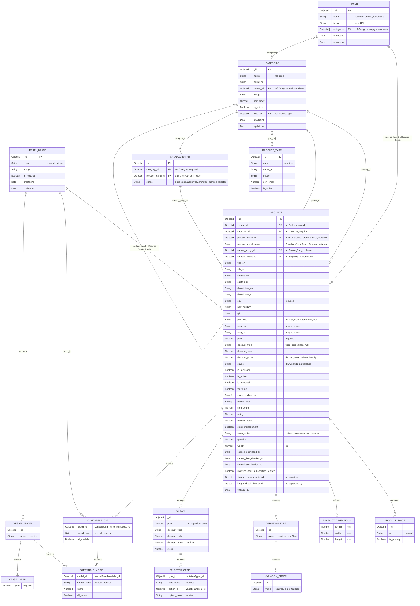

# Products, Categories & Brands — Data Architecture

How the three core catalog collections of Ready Marine are shaped and wired together,
taken straight from the Mongoose schemas in `Backend/models/`.

| Model (Mongoose) | Collection | Schema file |
|---|---|---|
| `Product` | `products` | [`Backend/models/products.js`](Backend/models/products.js) |
| `Category` | `categories` | [`Backend/models/categories.js`](Backend/models/categories.js) |
| `Brand` (product brand) | `brands` | [`Backend/models/product_brands.js`](Backend/models/product_brands.js) |
| `VesselBrand` (engine / boat make) | `vesselbrands` | [`Backend/models/vessel_brands.js`](Backend/models/vessel_brands.js) |

> **"Brand" means two different things in this codebase.**
> - **`Brand`** is the maker of the part itself: Racor, Sierra, Garmin. Admins type these in by hand.
> - **`VesselBrand`** is the make of the engine or boat a part fits: Yamaha, Mercury, Volvo Penta. It also carries the
>   models (hulls/engines) and their years.
>
> A product links to both. It has **one** product brand (`product_brand_id`), which can live in *either* collection,
> and **many** fitment makes (`compatible_vessels[].brand_id`), which always point at `VesselBrand`.

Two neighbouring collections show up because the core three reference them: `ProductType`
(`Backend/models/productTypes.js`), which categories belong to, and `CatalogEntry`
(`Backend/models/catalogEntries.js`), the master-catalog copy a product can be created from.

---

## 1. The big picture

```
                        ┌──────────────┐
                        │ ProductType  │
                        └──────▲───────┘
                               │ type_ids[]  (many-to-many)
                               │
          parent_id  ┌─────────┴────────┐   categories[]   ┌──────────┐
        ┌───────────►│     Category     │◄─────────────────│  Brand   │
        └────────────│  (self-tree)     │   (many-to-many) │ (brands) │
                     └─────────▲────────┘                  └────▲─────┘
                               │ category_id (required, N:1)    │
                               │                                │ product_brand_id
                     ┌─────────┴────────┐                       │ when source = "Brand"
                     │     Product      │───────────────────────┘
                     │                  │───────────────────────┐
                     └─────────┬────────┘                       │ product_brand_id
                               │ compatible_vessels[].brand_id     │ when source = "VesselBrand"
                               │ compatible_vessels[].models[].model_id
                               ▼                                ▼
                     ┌──────────────────────────────────────────────┐
                     │                VesselBrand                    │
                     │   models[] (embedded) → years[] (embedded)    │
                     └──────────────────────────────────────────────┘
```

---

## 2. Mermaid ER diagram

Embedded sub-documents (they live inside the parent document, not in their own collection)
are drawn as their own boxes with a `embeds` relationship so you can see their fields.



---

## 3. Field reference

### 3.1 `Product` — `products`

**References to other collections**

| Field | Type | Points to | Required | Notes |
|---|---|---|---|---|
| `vendor_id` | ObjectId | `Seller` | yes | indexed |
| `category_id` | ObjectId | `Category` | yes | indexed; the **leaf** (or any level) the product sits in |
| `product_brand_id` | ObjectId | `Brand` **or** `VesselBrand` | no (`null`) | polymorphic, resolved via `refPath: "product_brand_source"` |
| `product_brand_source` | String enum | — | default `"Brand"` | `Brand`, `VesselBrand`, `BoatBrand`, `MarineBrand`, `CarBrand`; stamped by a hook, see §4.2 |
| `catalog_entry_id` | ObjectId | `CatalogEntry` | no (`null`) | analytics link only; data was copied once at creation |
| `shipping_class_id` | ObjectId | `ShippingClass` | no (`null`) | indexed |
| `compatible_vessels[].brand_id` | ObjectId | `VesselBrand._id` | yes (inside entry) | **no `ref`**: can't be `populate()`d; the name is copied in `brand_name` |
| `compatible_vessels[].models[].model_id` | ObjectId | `VesselBrand.models[]._id` | yes (inside entry) | points into an embedded array, so there's no `ref` here either |

**Content & identity**

| Field | Type | Notes |
|---|---|---|
| `title_en` / `title_ar` | String | trimmed |
| `subtitle_en` / `subtitle_ar` | String | trimmed |
| `description_en` / `description_ar` | String | |
| `slug_en` / `slug_ar` | String | `unique` + `sparse` |
| `sku` | String | **required** |
| `part_number`, `gtin` | String | |
| `part_type` | String enum | `original`, `oem`, `aftermarket`, `null`; indexed |

**Pricing & stock**

| Field | Type | Notes |
|---|---|---|
| `price` | Number | **required** |
| `discount_type` | String enum | `fixed`, `percentage`, `null` |
| `discount_value` | Number | `min: 0` |
| `discount_price` | Number | **derived** in `pre('validate')` from the three fields above. The effective price everywhere is `discount_price ?? price` |
| `stock_management` | Boolean | default `true` |
| `stock_status` | String enum | `instock`, `outofstock`, `onbackorder` |
| `quantity` | Number | default `null` |
| `sold_count`, `rating`, `reviews_count` | Number | counters, default `0` |

**Status & visibility**

| Field | Type | Notes |
|---|---|---|
| `status` | String enum | `draft` → `pending` → `published` |
| `is_published` | Boolean | stays `true` once an admin has approved it, even if it goes back to draft |
| `is_active` | Boolean | `false` hides it from the marketplace (vendor suspended, subscription expired) |
| `subscription_hidden_at` | Date | |
| `modified_after_subscription_restore` | Boolean | forces a re-review |
| `review_fixes` | [String] | what the admin corrected during review |
| `catalog_dismissed_at`, `catalog_link_checked_at` | Date | admin catalog worklists |
| `fitment_check_dismissed` | `{ at: Date, signature: String }` | |
| `image_check_dismissed` | `{ at: Date, signature: String, by: String }` | |

**Fitment & targeting**

| Field | Type | Notes |
|---|---|---|
| `is_universal` | Boolean | fits everything |
| `compatible_vessels` | [CompatibleCar] | see embedded docs below |
| `for_trunk` | Boolean | "every boat should carry this" list (legacy name from the car project) |
| `target_audiences` | [String] | cleaned on set against `AUDIENCE_KEYS` in `services/shared/audiences.js`; indexed |

**Shipping**: `weight` (Number, kg), `dimensions` (`{ length, width, height }`, cm).

**Timestamps**: `created_at` only (`timestamps: false`, so there's no `updatedAt`).

**Embedded sub-documents**

| Sub-document | Fields | Own `_id`? |
|---|---|---|
| `images[]` | `url` (String, req), `is_primary` (Boolean) | yes |
| `variation_types[]` | `name` (String, req), `options[]` → `{ value: String req }` | yes / yes |
| `variants[]` | `price` (Number, `null` = base price), `discount_type`, `discount_value`, `discount_price` (derived), `stock`, `selected_options[]` | yes |
| `variants[].selected_options[]` | `type_id`, `type_name` (req), `option_id`, `option_value` (req) | no |
| `compatible_vessels[]` | `brand_id` (req), `brand_name` (req), `all_models`, `models[]` | no |
| `compatible_vessels[].models[]` | `model_id` (req), `model_name` (req), `years` [Number], `all_years` | no |
| `dimensions` | `length`, `width`, `height` | no |

**Validation rules (in `pre('validate')`)**

1. `discount_price` is recalculated on the product and on every variant. A discount bigger than the price fails validation.
2. A `published` product needs title + subtitle + description + slug complete in **at least one** language.
3. A product has to be `is_universal` **or** have at least one `compatible_vessels` entry.

**Indexes**: text index on title/subtitle/description (both languages); `{vendor_id, category_id}`;
`{status, created_at}`; `{vendor_id, status, created_at}`; `{status, price}`; `{status, sold_count, created_at}`;
plus single-field indexes on `vendor_id`, `category_id`, `product_brand_id`, `catalog_entry_id`,
`shipping_class_id`, `part_type`, `target_audiences`.

### 3.2 `Category` — `categories`

| Field | Type | Notes |
|---|---|---|
| `_id` | ObjectId | |
| `name` | String | **required**, trimmed (English) |
| `name_ar` | String | trimmed |
| `parent_id` | ObjectId → `Category` | default `null` (top level); indexed. **Self-reference that builds the tree** |
| `image` | String | |
| `sort_order` | Number | default `0` |
| `is_active` | Boolean | default `true`; indexed |
| `type_ids` | [ObjectId → `ProductType`] | default `[]`; indexed. Can sit at any level, and a category can have several types |
| `createdAt` / `updatedAt` | Date | `timestamps: true` |

There's no slug and no depth limit. The schema doesn't stop a category from ending up as its own ancestor.

### 3.3 `Brand` — `brands` (part maker)

| Field | Type | Notes |
|---|---|---|
| `_id` | ObjectId | |
| `name` | String | **required**, **unique**, trimmed, **forced to lowercase** |
| `image` | String | logo URL |
| `categories` | [ObjectId → `Category`] | the categories this brand makes things for. **Empty = unknown = shown everywhere**, not "none". A parent category covers every category under it |
| `createdAt` / `updatedAt` | Date | `timestamps: true` |

### 3.4 `VesselBrand` — `vesselbrands` (engine / boat make)

| Field | Type | Notes |
|---|---|---|
| `_id` | ObjectId | |
| `name` | String | **required**, **unique**, trimmed (case is kept) |
| `image` | String | |
| `is_featured` | Boolean | default `false` |
| `models[]` | `{ _id, name: String req, years: [{ year: Number req }] }` | models have their own `_id` (that's what `model_id` points at); years don't |
| `createdAt` / `updatedAt` | Date | `timestamps: true` |

The same schema is registered under **four model names**: `VesselBrand`, `BoatBrand`, `MarineBrand` and `CarBrand`
(legacy, re-exported from `car_brands.js`). Since the schema pins `collection: "vesselbrands"`, all four read and
write the **same collection**.

---

## 4. Relationships, explained with examples

### 4.1 Product → Category (many-to-one, required)

Every product sits in exactly one category. Categories form a tree through `parent_id`:

```js
// categories
{ _id: C1, name: "Engine",       name_ar: "المحرك",        parent_id: null }
{ _id: C2, name: "Fuel System",  name_ar: "منظومة الوقود",  parent_id: C1 }
{ _id: C3, name: "Fuel Filters", name_ar: "فلاتر الوقود",   parent_id: C2 }

// products
{ _id: P1, title_en: "Racor 10-micron fuel filter", category_id: C3, ... }
```

- **Breadcrumb.** The product page walks up `category_id → parent_id → parent_id`, which gives
  *Engine › Fuel System › Fuel Filters*. This only works if `parent_id` is populated at each level.
- **Filtering includes children.** `GET /products?category_id=C1` doesn't match `category_id === C1` only.
  `getDescendantCategoryIds()` in `services/productService.js` collects C1, C2 and C3, then queries
  `category_id: { $in: [...] }`. So P1 shows up under "Engine".

### 4.2 Product → Brand **or** VesselBrand (polymorphic, optional)

`product_brand_id` holds one ObjectId. `product_brand_source` says which collection it belongs to, and Mongoose
uses that to `populate()`:

```js
// A part from a third-party maker
{ title_en: "Racor fuel filter",  product_brand_id: B_racor,  product_brand_source: "Brand" }
//   brands:       { _id: B_racor, name: "racor", categories: [C2] }

// A genuine Yamaha part — the make is reused, so nobody types "Yamaha" a second time
{ title_en: "Yamaha water pump impeller", product_brand_id: V_yamaha, product_brand_source: "VesselBrand" }
//   vesselbrands: { _id: V_yamaha, name: "Yamaha", models: [...] }
```

Nobody sets the source by hand. `attachBrandSourceHooks()` in `services/shared/brandRef.js` looks the id up in
`vesselbrands` (cached for 60 seconds) and stamps `"VesselBrand"` if it's there, otherwise `"Brand"`. The hook runs
on `save()`/`validate` and on `findOneAndUpdate()` / `findByIdAndUpdate()`.

For the brand pickers in the UI, `mergedProductBrands()` returns **both lists merged into one**. If a hand-entered
`Brand` has the same name as a vessel make, only the hand-entered one is kept, so an admin can override a make's logo
or category tags.

### 4.3 Product → VesselBrand through fitment (`compatible_vessels`, many-to-many, denormalised)

Fitment is stored **inside the product**. It references the make and its model by id and keeps a copy of their
names:

```js
// vesselbrands
{ _id: V_yamaha, name: "Yamaha",
  models: [ { _id: M_f115, name: "F115", years: [{year: 2018}, {year: 2019}, {year: 2020}] },
            { _id: M_f150, name: "F150", years: [...] } ] }

// products
{ title_en: "Yamaha water pump impeller",
  is_universal: false,
  compatible_vessels: [
    { brand_id: V_yamaha, brand_name: "Yamaha", all_models: false,
      models: [ { model_id: M_f115, model_name: "F115", years: [2018, 2019], all_years: false },
                { model_id: M_f150, model_name: "F150", years: [],           all_years: true  } ] }
  ] }
```

The matching rule (as used in `frontend/src/app/product/[slug]/page.js` → `resolveCompatibility`) checks these in
order:

1. `is_universal: true` → fits every vessel.
2. A `compatible_vessels` entry with the same `brand_id` and `all_models: true` → fits every model of that make.
3. A model with the same `model_id` and `all_years: true` → fits every year of that model.
4. Otherwise the vessel's year has to be in `years`.

A Yamaha F115 from 2019 fits the product above, and a 2021 one doesn't. Any F150 fits.

Because `brand_id` and `model_id` have **no `ref`**, the names you read come from `brand_name` and `model_name`, which
were copied in when the product was saved.

### 4.4 Category → Category (self-reference, tree)

`parent_id: null` marks a top-level category, and any other value names its parent. There's no `children` array: you
find a category's children by querying `{ parent_id: X }`.

### 4.5 Brand → Category (many-to-many, from the brand's side)

The brand stores the list (`Brand.categories`). Categories don't know which brands they have.

```js
{ name: "racor",  categories: [C2] }   // Fuel System, and so Fuel Filters under it too
{ name: "garmin", categories: [C7] }   // Electronics
{ name: "sierra", categories: [] }     // not tagged yet → offered in every category
```

The brand filter uses this to hide brands that don't fit the category being browsed. An empty list means "nobody has
tagged it yet", so the brand stays visible everywhere until someone tags it. Vessel makes always come through with
`categories: []`, which means they show up in every category.

Note that `Brand.categories` **doesn't** decide which brands a product can pick. Any brand can be put on any product.

### 4.6 Category → ProductType (many-to-many)

```js
// producttypes
{ _id: T_parts, name: "Spare parts" }
{ _id: T_maint, name: "Routine maintenance" }

// categories
{ name: "Fuel Filters", parent_id: C2, type_ids: [T_parts, T_maint] }
```

When a shopper opens "Routine maintenance", the shop collects every **active** category tagged with `T_maint`, plus
**all** their descendants, and lists the products in them. Products have no type of their own: they inherit it from
their category.

### 4.7 Product → CatalogEntry (optional, one-way copy)

A catalog entry has the same fields as a product (title, `category_id`, polymorphic `product_brand_id`, images,
`compatible_vessels`, `variation_types`) but **no price, stock or vendor**. When a vendor picks an entry, its data is
copied into a new product and `catalog_entry_id` keeps the link. Editing the entry later **doesn't** change the
product. The link is only there to answer "which sellers carry this part, and at what price".

---

## 5. Things to know before you change this

1. **The brand source is only stamped on some write paths.** The hook covers `save()` and
   `findOneAndUpdate()` / `findByIdAndUpdate()`. Writing `product_brand_id` through `updateOne`, `updateMany`,
   `bulkWrite` or the raw driver leaves `product_brand_source` untouched, so `populate('product_brand_id')` can come
   back with nothing. Set the source yourself in those cases (`resolveBrandSource(id)`).
2. **Copied names go stale.** `compatible_vessels[].brand_name` and `models[].model_name` are copies. Renaming a vessel
   make or model doesn't update existing products.
3. **Deleting a model breaks fitment quietly.** `model_id` points into `VesselBrand.models[]`. If the model is
   removed, products keep an id that no longer exists, and nothing at the database level catches it.
4. **Nothing cascades.** MongoDB has no foreign keys. Deleting a `Category`, `Brand` or `VesselBrand` doesn't touch
   the products, child categories or `Brand.categories` lists that point at it. Any clean-up has to happen in the
   service layer.
5. **The source enum is bigger than what's actually written.** It allows five values, but the resolver only ever
   writes `"Brand"` or `"VesselBrand"`. The other three are aliases for the same `vesselbrands` collection, so
   `populate` still works with them.
6. **Brand names are stored in lowercase** (`lowercase: true`). The UI capitalises them for display. Vessel make
   names keep their case.
7. **Car-era names are still around.** `compatible_vessels`, `CarBrand`, `for_trunk`, and some comments come from the
   ReadyCar codebase. In Ready Marine they mean boat/engine fitment and "every boat should carry this".
8. **Reseeding wipes products.** `node ./seeders/marineCatalogSeeder.js --reset` rebuilds the vessel makes, brands
   and categories, and **deletes existing products**.
